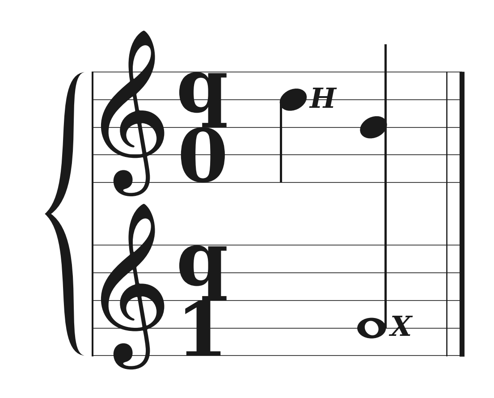
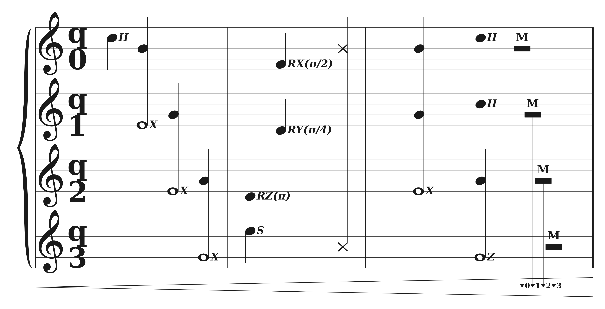
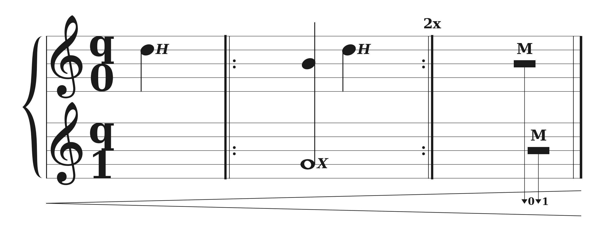
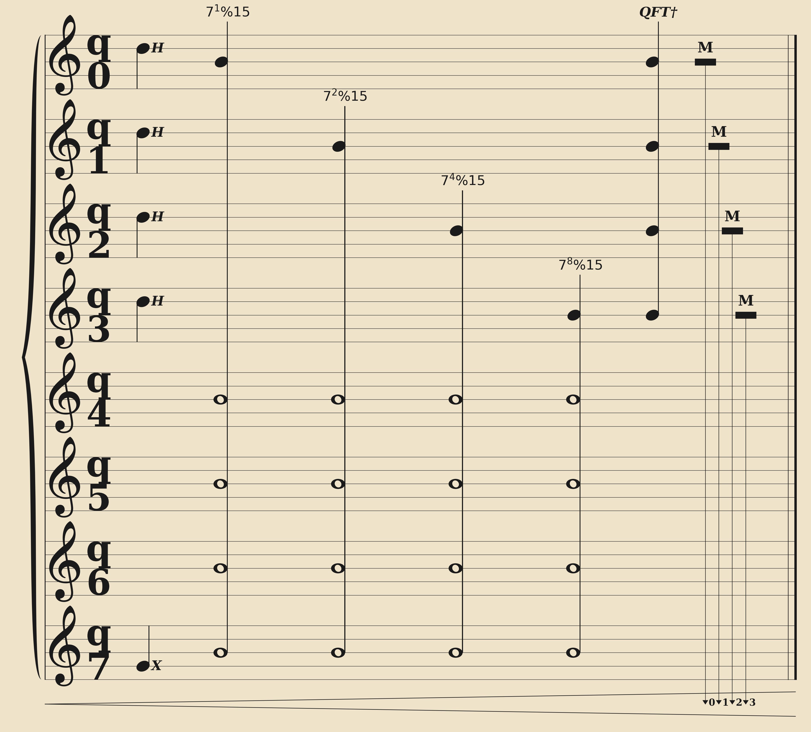

# QuantumSheets

[](https://pypi.org/project/QuantumSheets/)

QuantumSheets is a Python library that renders Qiskit quantum circuits as classical sheet music. It maps quantum gates to musical notes on a staff, providing an alternative visual representation for quantum algorithms.

## Example: Qiskit Hello World

The two-qubit Bell-state circuit from the [Qiskit quickstart](https://quantum.cloud.ibm.com/docs/en/guides/quick-start), rendered as classical sheet music on a white background. A Hadamard gate puts the first qubit in superposition, and a CNOT gate entangles the pair.



<video src="https://github.com/user-attachments/assets/79605564-7c13-4802-95de-facac0ac2387" controls width="100%"></video>

## Installation

You can install QuantumSheets directly from [PyPI](https://pypi.org/project/QuantumSheets/):

```bash
pip install QuantumSheets
```

## Features

### 1. Classical Registers, Chords & Parameter Expressions

- **Classical Registers**: Displays classical bits as a crescendo (`<`) across the bottom of the system, with individual qubit measurement drop lines and bit indicators (`▾0`, `▾1`, `▾2`, `▾3`).
- **Musical Notation**: Single-qubit gates render as notes and multi-qubit gates (CNOT, Toffoli, CZ, SWAP) render as polyphonic chords with authentic stems and clefs.
- **Parameter Expressions**: Uses SymPy to format mathematical parameters into musical notation (e.g., `RX(π/2)`, `RY(π/4)`, `RZ(π)`).



<video src="https://github.com/user-attachments/assets/a46ecd58-5853-424b-9eaf-ce0660a42772" controls width="100%"></video>

### 2. Control Flow (Loops & Repeat Barlines)

- **Control Flow**: Natively unrolls Qiskit loops (`ForLoopOp`, `WhileLoopOp`) and renders them using authentic musical repeat barlines (`|:` and `:|`) with repeat counts (`2x`), playing each iteration in sequence.



<video src="https://github.com/user-attachments/assets/0dbed328-e05c-4a4d-a563-ed21f37e7b40" controls width="100%"></video>

### 3. MathText Labels & Custom Sub-circuits

- **MathText Rendering**: Supports LaTeX/MathText in custom gate labels (e.g., `$7^{1} \\% 15$`).
- **Sub-circuits**: Unpacks custom sub-circuits (such as `QFT†`) and brackets their internal notes into grouped phrases.
- **Visual Styles**: Choose between clean modern white (`style="clean"`) and vintage parchment (`style="ink"`).



<video src="https://github.com/user-attachments/assets/8e955dd0-1e50-4304-a825-4e97018c7e8c" controls width="100%"></video>

### 4. Audio Synthesis

- **Acoustic Piano DSP (`.wav`)**: Generates 16-bit PCM WAV audio using an acoustic piano synthesis model with hammer strike transients, string inharmonicity, 3-string unison chorus detuning, phase dispersion, and soundboard comb reflections.
- **Musical Note Timing**: Target gates ring out as full whole notes while control gates trigger crisp, shorter taps.

## Quickstart

```python
from qiskit import QuantumCircuit
from QuantumSheets import draw_circuit, generate_audio

qc = QuantumCircuit(2)
qc.h(0)
qc.cx(0, 1)

# Render classical notes on a white background
draw_circuit(qc, filename="hello_world_score.png", style="clean", strip=True)

# Synthesize the circuit's audio to WAV (acoustic grand piano)
generate_audio(qc, filename="hello_world_score.wav", bpm=120)
```

To regenerate the example scores and WAVs from the repository root:

```bash
python docs/hello_world.py
python docs/loop_circuit.py
python docs/my_circuit.py
python docs/test_shor.py
```

## License
MIT License
